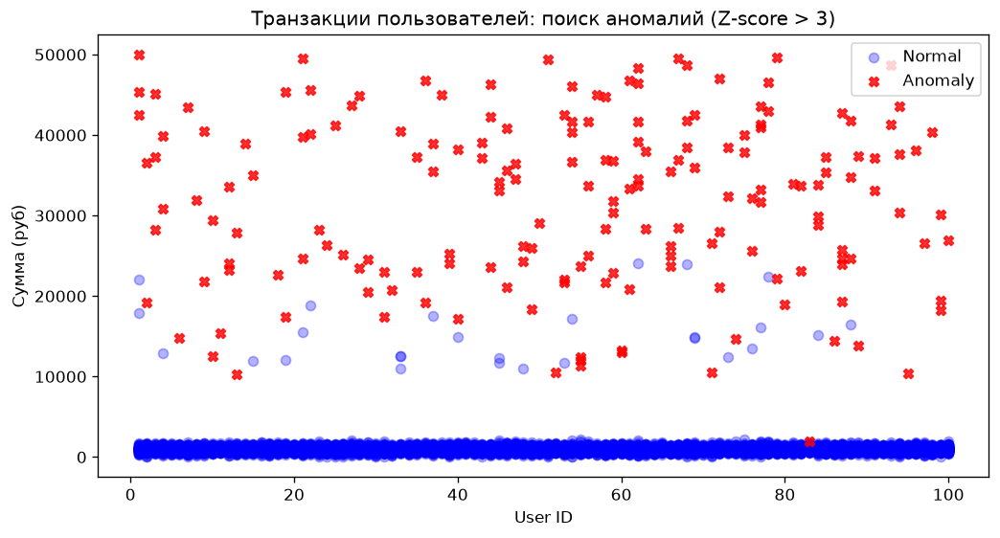

# Transaction Anomaly Monitor

Учебно-портфолио проект: автоматизированный поиск аномальных транзакций клиентов на основе статистического анализа (Z-score).

## Бизнес-задача
Ежедневно банк обрабатывает тысячи транзакций. Служба безопасности должна оперативно выявлять подозрительные операции (например, когда клиент внезапно тратит сумму, в разы превышающую его обычный средний чек). Данный проект моделирует пайплайн поиска таких аномалий для снижения рисков мошенничества.

## Стек
- **PostgreSQL 16** (в проде — GreenPlum)
- **Python 3.14**: pandas, numpy, sqlalchemy, matplotlib
- **Docker**, Git
- **AI-ассистент** (DeepSeek) — использован для генерации синтетических данных и документации

## Быстрый старт

1. Поднять базу данных:
   ```bash
   docker compose up -d
2. Применить схему БД (локальный psql не требуется):
Для Windows (PowerShell):
Get-Content sql/01_schema.sql -Raw | docker compose exec -T db psql -U postgres -d transactions_db
Для macOS / Linux:
docker compose exec -T db psql -U postgres -d transactions_db < sql/01_schema.sql
3. Сгенерировать данные и запустить пайплайн:
   ```bash
   python data/generate_data.py
   python scripts/load_to_db.py
   python run.py
   
## Пример работы (визуализация)
На графике синим цветом показаны обычные транзакции, а красными крестиками — выявленные аномалии (Z-score > 3):


## Что демонстрирует проект
pandas: groupby + transform (расчет среднего и стандартного отклонения по каждому клиенту в рамках его группы), np.where (бинарная классификация), unstack (сводные таблицы), .str методы.
Статистика: расчет Z-score для поиска выбросов.
Воспроизводимый пайплайн: генерация «грязных» данных с аномалиями → загрузка в БД → аналитика → визуализация.
Git-flow: осмысленные коммиты, разделение на фичи.